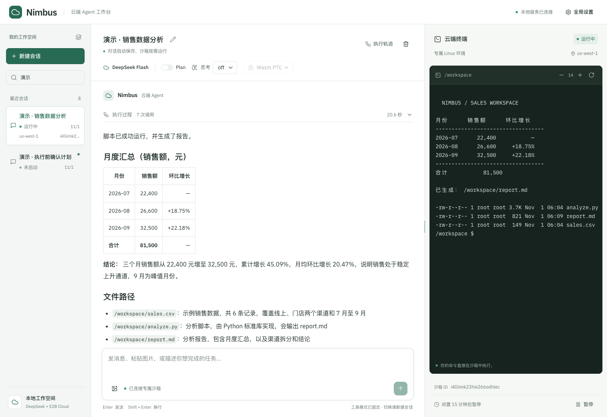
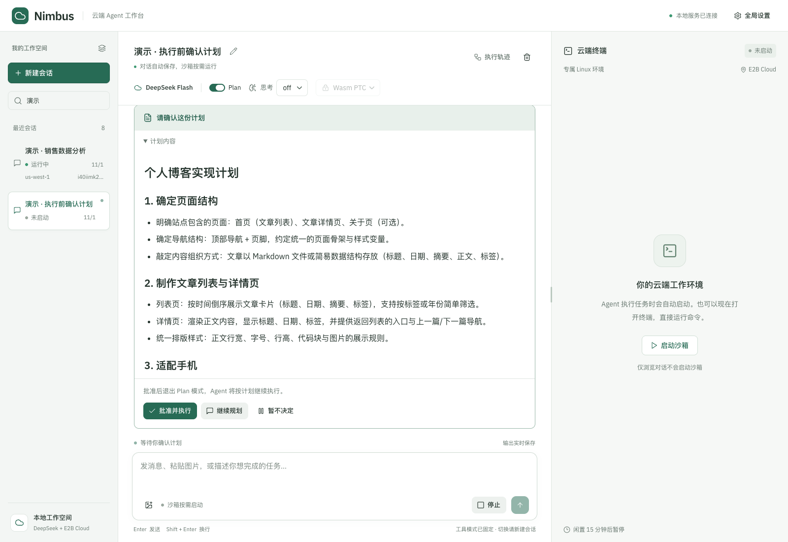
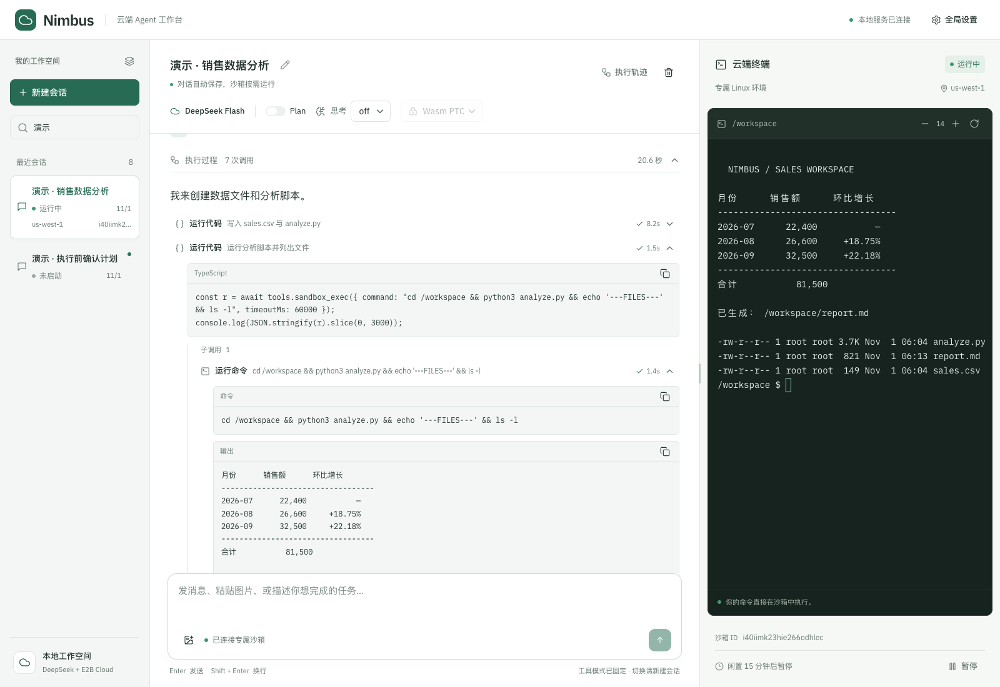

# Nimbus Cloud Agent

**A local workspace for an agent that works in the cloud.**

Plan a task, review its execution, and work with the resulting files in a live terminal. Nimbus runs on **macOS or Linux**, with **DeepSeek Flash** for reasoning and **E2B** for isolated Linux execution. Your computer runs the control plane; no local VM, Docker, or dedicated Linux host is required.

[Quick start](#quick-start) · [Deployment guide](docs/deployment.md) · [Architecture](ARCHITECTURE.md) · [Contributing](CONTRIBUTING.md)



*Captured from a running local instance using synthetic sales data. The current interface is in Chinese.*

## Features

- **Chat, images, and tools.** Use DeepSeek Flash with text and image input, Markdown responses, and expandable tool calls. Inspect nested Wasm PTC calls and their results.
- **Review before execution.** Plan mode presents a native review card: approve, request changes, or defer. Pending reviews survive a browser refresh.
- **A cloud workspace per session.** Commands and files run in an on-demand E2B sandbox. Open its real terminal, resize it, send Ctrl-C, or pause and resume the sandbox.
- **Durable conversations.** PostgreSQL stores history, attachments, tool output, settings, and pending messages. Event streams reconnect and catch up without browser polling.
- **Persistent agent runtime.** Go supervises one `nimbus-agent-runtime` process wrapping DeepSeek Harness. Node restarts do not disconnect the Go-owned terminal.
- **Skills and MCP.** Manage multi-file Skills and connect Streamable HTTP MCP services, including OAuth authorization.

Standard / Wasm PTC is fixed after a session's first message. Plan and thinking settings can change for later turns. Pure chat, image analysis, and MCP-only tasks do not create a sandbox.

## Screenshots

| Plan review | Inspect tool execution |
| --- | --- |
| [](docs/media/plan-review.png) | [](docs/media/tool-calls.png) |
| Confirm the plan before the agent continues. | Expand a call to inspect its arguments and output. |

## Quick start

You will need **Node.js 24.11+**, **Go 1.25+**, a **DeepSeek API key**, and an **E2B API key**. The macOS setup also requires Homebrew and installs PostgreSQL 17 if needed.

```sh
git clone https://github.com/nimbus-cloud-agent/nimbus-cloud-agent.git
cd nimbus-cloud-agent

# Install dependencies, initialize local PostgreSQL, and build both packages.
npm run setup:mac

# Replace the placeholders with your own keys.
export NIMBUS_DEEPSEEK_API_KEY='your-deepseek-api-key'
export NIMBUS_E2B_API_KEY='your-e2b-api-key'

npm start
```

Open **http://127.0.0.1:8080**. The first sandbox task creates its E2B workspace automatically.

For Linux, an existing PostgreSQL server, separate release artifacts, configuration, backups, and troubleshooting, see the **[local deployment guide](docs/deployment.md)**.

### Try it

1. Create a session and select Standard or Wasm PTC.
2. Ask: “Generate a sample sales CSV, analyze it with Python, and save a Markdown report in `/workspace`.”
3. Expand the tool calls to see what ran. In the terminal, run `ls -lh /workspace` and inspect the files.
4. Enable Plan for a new task to review its proposed steps before continuing.

DeepSeek and E2B requests use your own accounts and may incur usage charges. Nimbus is a single-user application bound to loopback; it does not include public hosting or multi-user authentication.

### Daily use

Run these commands from the repository directory:

```sh
npm start                 # foreground; Ctrl-C stops Nimbus
npm run start:background  # background; logs in .local/nimbus.log
npm stop                  # stop the background service
```

The source launcher also reads the ignored `deepseekkey` and `e2bhobbykey` files if the corresponding environment variables are unset. It does not automatically load `.env` files. Stopping Nimbus leaves PostgreSQL data intact.

## How it fits together

```text
Browser ── HTTP / SSE / WebSocket ── Go control plane
                                    ├── PostgreSQL: history and settings
                                    ├── E2B: sandboxes, files, commands, PTYs
                                    └── JSON-RPC 2.0 / stdio
                                         nimbus-agent-runtime
                                         └── DeepSeek Harness + Wasm PTC
```

`nimbus-agent-runtime` is a separately packaged TypeScript wrapper with an explicit DeepSeek Harness dependency. Go owns E2B credentials and sandbox operations; the agent requests those capabilities through reverse RPC. Only the frontend is embedded in the Go executable.

The current pair is **runtime 0.3.0 / protocol v3**. Upgrade the Go executable and runtime together. The npm package is not yet published to the public registry; source checkouts build it locally, and standalone installations use the generated tarball.

## Development

```sh
npm ci
make             # generate protocol → build runtime, UI, and Go
make test        # TypeScript tests and Go race tests
go vet ./...
```

Generated code and build artifacts are ignored by Git. Make generates the shared Go/TypeScript RPC bindings automatically. PostgreSQL integration tests require a test database:

```sh
NIMBUS_TEST_DATABASE_URL='postgres://nimbus@127.0.0.1:55432/nimbus?sslmode=disable' make test
```

Tests use disposable schemas. Real model, sandbox, browser, and crash-recovery checks are documented in [Verification](docs/VERIFICATION.md); run those sequentially in a disposable workspace.

## Documentation

| Guide | Contents |
| --- | --- |
| [Local deployment](docs/deployment.md) | macOS setup, Linux/existing PostgreSQL, configuration, updates, backups, troubleshooting |
| [Packaging](docs/packaging.md) | Build and install the Go executable and runtime npm package separately |
| [Architecture](ARCHITECTURE.md) | Process boundaries, typed models, sandbox ownership, persistence, and streaming |
| [HTTP API](docs/API.md) | Sessions, images, Plan review, event streams, and terminal WebSockets |
| [Runtime RPC](docs/RUNTIME_RPC.md) | Generated protocol, SDK adapters, cancellation, and compatibility |
| [Verification](docs/VERIFICATION.md) | Automated checks, real end-to-end results, and known limits |

## Contributing

Issues and pull requests are welcome. Read [CONTRIBUTING.md](CONTRIBUTING.md) for development conventions and [SECURITY.md](SECURITY.md) for security reports. For substantial changes, open an issue to discuss the design first.

## License

[MIT](LICENSE).
